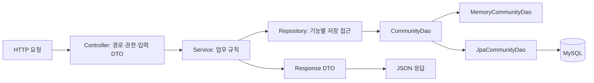
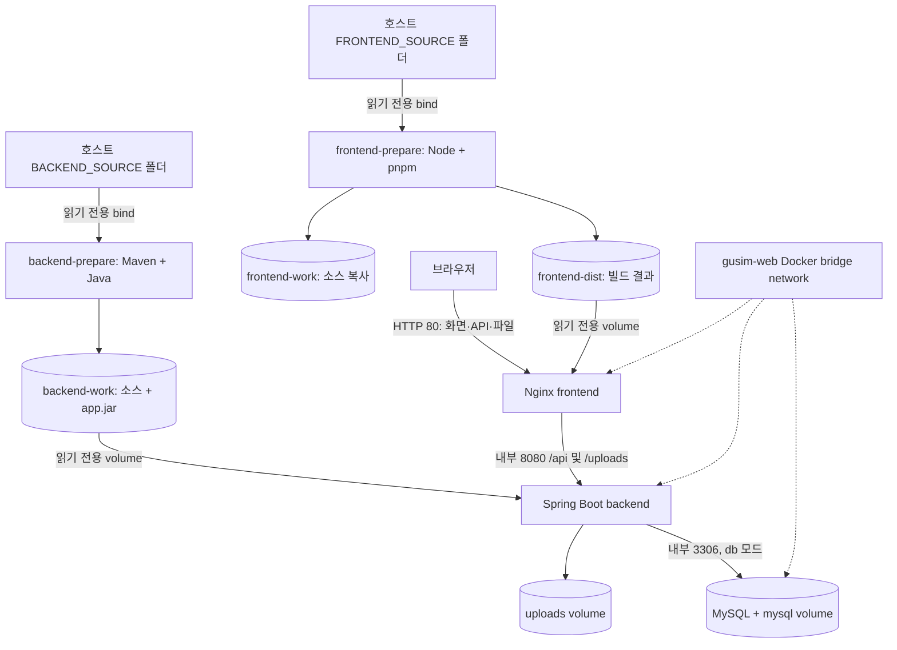

# 구도와 심도

사진 동아리의 소개·임원진·사진 공유·회원 커뮤니티입니다. **React + Tailwind CSS** 프론트엔드와 **Spring Boot + JPA** 백엔드로 구성됩니다. 회원가입은 제공하지 않으며 관리자만 계정을 발급합니다.

## 이번 구조와 동작

- 게시글 목록·상세 화면은 회원 태그 대신 **프로필 사진 + 이름**, 그 아래 줄에 **작성 시각**을 표시합니다. 작성자의 현재 이름과 개인 프로필 사진을 사용합니다.
- 프로필 사진이나 이름을 누르면 `/members/:id`로 이동합니다. 회원 페이지는 마이페이지와 같은 프로필·소개·장비·공유 사진 레이아웃을 사용하며 모든 편집 기능을 제외한 조회 전용입니다.
- 로그인 후 게시판 옆의 **부원 목록**(`/members`)에서 활성 부원을 확인할 수 있습니다. 전체 보기에서 임원진이 위에 나오며, 임원진/일반 부원 탭도 제공합니다. 각 그룹은 한국어 가나다순, 이름이 같으면 숫자 ID순으로 정렬합니다.

- 게시판은 여러 사진을 첨부할 수 있으며 **사진 한 장당 50MB, 원본 파일 합계 100MB 이하**입니다. 크리틱은 **사진 1~2장**, 사진 공유는 기존처럼 1장입니다.
- 게시판 카테고리는 **잡담(CHAT) / 질문(QUESTION) / 정보(INFO)**이며 목록에서 전체/분류별 필터를 제공합니다. 작성 화면에서 첨부 사진 미리보기·사진별 제외·합계 용량을 확인할 수 있습니다.
- 사진 공유·크리틱·게시판 카드는 `/posts/:id` 상세 페이지로 이동하며 전체 사진과 본문을 보여줍니다.
- 크리틱·게시판 목록의 우측 작성 버튼은 `/critique/write`, `/board/write`로 이동합니다. 게시판 사진은 선택, 사진 공유·크리틱은 필수입니다.
- 작성자 본인은 상세 페이지에서 **내 글 수정** 또는 삭제를 선택할 수 있습니다. 수정 페이지 `/posts/:id/edit`에서 제목·내용·게시판 분류·기존 사진 유지/제외·새 사진 추가를 편집합니다. 서버도 작성자 ID를 검사합니다.
- 마이페이지의 내 카메라 장비와 장비 관리 목록은 왼쪽에 장비 정보, 오른쪽에 설명을 표시합니다.
- 서버가 반환한 오류 문구는 공통 알림 팝업과 해당 화면에 표시합니다.
- 신규 회원 초기 비밀번호는 **gusim1234**, 변경 비밀번호는 **8~60자**입니다. 마이페이지에서 현재 비밀번호를 확인한 뒤 본인이 변경할 수 있으며, 변경 후 다시 로그인합니다.
- 장비에 최대 1,000자의 설명을 추가할 수 있습니다.

- 헤더는 `frontend/src/components/Header.jsx`, 로그인은 `frontend/src/pages/auth/Login.jsx`로 분리했습니다.
- 헤더의 로고·게시판 메뉴는 왼쪽, 로그인/프로필은 오른쪽에 배치했습니다. 작은 화면에서는 메뉴를 펼쳐볼 수 있습니다.
- 비로그인: 동아리 소개 / 임원진 / 사진들. 로그인: 크리틱 / OT / 게시판 추가. 관리자: 관리자 메뉴 추가.
- 관리자 화면 `/admin`: 회원 추가·정보 수정·활성/비활성·관리자 지정·비밀번호 초기화, 임원진 추가/수정/삭제, OT 편집.
- 임원진은 **기존 활성 회원 중 선택**합니다. 지정하면 ADMIN 권한과 직책 태그가 부여됩니다. 카드 이름은 회원 이름을 따르고, **카드 왼쪽 소개 사진**은 개인 프로필과 별도로 업로드합니다. 직책·소개·순서도 수정할 수 있습니다.
- 크리틱은 사진 첨부가 필수입니다. 작성 시 미리보기를 제공하고 게시글에서 사진을 표시합니다.
- OT는 관리자가 편집하고 부원이 읽는 단일 안내 페이지입니다. 일반 게시글 작성 화면이 아닙니다.
- 메모리/DB 두 저장소 구현은 그대로 유지하며 API와 화면은 공통입니다.

## 기술 스택

| 영역       | 기술                                      | 역할                                                    |
| ---------- | ----------------------------------------- | ------------------------------------------------------- |
| 프론트엔드 | React, React Router                       | 페이지 구성, 상태 관리, 클라이언트 경로 보호            |
| 디자인     | Tailwind CSS 4, lucide-react              | 반응형 유틸리티 스타일, 아이콘                          |
| 빌드       | Vite, pnpm                                | 개발 프록시와 정적 파일 빌드, lockfile 기반 의존성 설치 |
| 백엔드     | Java 21, Spring Boot 3.5.16, Maven        | REST API, 유효성 검증, 실행 JAR                         |
| 인증       | HttpSession, Spring Security CSRF, BCrypt | 세션 쿠키·CSRF 방어·비밀번호 해시                       |
| 저장소     | JPA/Hibernate 또는 메모리 DAO             | ORM 영속화 또는 DB 없는 개발                            |
| 운영 DB    | MySQL 8.4                                 | 계정·게시글·장비·콘텐츠 영구 저장                       |
| 테스트     | JUnit, MockMvc, H2                        | 메모리와 JPA에 동일한 API 계약 테스트                   |
| 운영       | Docker Compose, Nginx, GitHub Actions     | 소스 복사·빌드·실행, API 프록시, CI 이미지 발행         |

Tailwind는 Vite 플러그인으로 빌드합니다. `styles.css`의 `@import "tailwindcss"`, 공통 스타일의 `@apply`, JSX의 유틸리티 클래스를 사용하며 기존 `overrides.css`는 제거했습니다. [Tailwind 공식 Vite 설치 안내](https://tailwindcss.com/docs/installation/using-vite)

## 디렉터리와 각 요소의 역할

```text
frontend/
  src/
    assets/logo.png             독립적으로 배포할 수 있도록 프론트 폴더 안에 로고 배치
    components/
      Header.jsx               좌측 메뉴 / 우측 로그인·프로필 / 관리자 탭
      PageTitle.jsx            공통 페이지 제목
      Protected.jsx            로그인·관리자 화면 접근 제어
      OfficerCard.jsx          왼쪽 사진이 있는 임원진 카드
      MemberBadges.jsx         일반 회원/직책 태그 표시
      PostCard.jsx             첫 사진·본문 링크와 별도 작성자 링크
      PostAuthor.jsx           프로필·이름 링크와 다음 줄 작성 시각
      Avatar.jsx               프로필 이미지 또는 기본 아이콘
      MemberProfileLayout.jsx  본인/다른 회원이 공유하는 프로필 레이아웃
      EquipmentRow.jsx         장비 정보 왼쪽·설명 오른쪽 공통 행
      MessageDialog.jsx        API 오류·안내 팝업
      index.js                 공통 컴포넌트 내보내기
    pages/
      auth/Login.jsx           로그인 전용 페이지; 회원가입 없음
      admin/
        AdminPage.jsx          회원 / 임원진 / OT 탭
        MembersPanel.jsx       계정 발급·정보·권한·활성 상태·비밀번호 관리
        OfficersPanel.jsx      소개 카드와 사진 관리
        OtPanel.jsx            OT 제목·본문 편집
      Orientation.jsx          회원용 OT 읽기 화면
      Officers.jsx             공개 임원진 목록
      Board.jsx                크리틱·일반 게시판
      MyPage.jsx               내 프로필·장비·사진·로그아웃
      MemberProfile.jsx        다른 회원의 조회 전용 프로필
      Members.jsx              가나다순 부원 목록·임원진 구분
      UploadPhoto.jsx          사진 공유 작성 화면 연결
      ComposePost.jsx          사진 공유·크리틱·게시판 공통 글쓰기·다중 사진·분류 선택
      PostDetail.jsx           첨부 순서별 전체 사진·본문·본인 글 수정/삭제
      EditPost.jsx             기존 글 불러오기·작성자 확인·수정 폼 연결
      auth/ChangePassword.jsx  본인 비밀번호 변경
    services/community.js      API 요청, CSRF, 업로드, 오류 처리
    context.jsx                세션 확인, 사용자 정보, 공개 사진 목록
    main.jsx                   라우트와 레이아웃
    styles.css                 Tailwind 테마·공통 컴포넌트 스타일
  vite.config.js               React/Tailwind 플러그인과 개발 API 프록시
  nginx.conf                   SPA fallback, API/파일 프록시
backend/src/main/java/club/gusim/
  Application.java
  auth/
    controller/LoginController.java  로그인·로그아웃 HTTP 진입점
    service/LoginService.java        인증·세션 검증·관리자 권한 확인
    repository/LoginRepository.java  학번 기반 로그인 조회
  controller/                  HTTP 매핑, DTO 검증, 인증 확인, 응답 상태
  service/                     회원 관리·콘텐츠·장비·업로드 업무 규칙
  repository/                  회원·커뮤니티·콘텐츠별 저장 인터페이스 역할
  dao/
    CommunityDao.java          두 저장소의 공통 저수준 데이터 접근 계약
    memory/MemoryCommunityDao.java   ConcurrentHashMap 기반, 재시작 시 초기화
    jpa/JpaCommunityDao.java         EntityManager 기반, 트랜잭션 안에서 DB 접근
  dto/
    Requests.java              입력 record와 Bean Validation 조건
    Responses.java             응답 record; 엔티티를 직접 반환하지 않음
  domain/                      JPA 엔티티와 테이블 매핑
  config/
    SecurityConfig.java        CSRF 필터·BCrypt
    WebConfig.java             업로드 파일 제공
    AdminBootstrap.java        활성 관리자가 없을 때 최초 관리자 생성
backend/src/main/resources/
  application.yml              포트·업로드·세션·최초 관리자 설정
  application-memory.yml       DB 자동 구성 제외
  application-db.yml           DB 접속·JPA validate
backend/src/test/              메모리/JPA 공통 인증·관리·콘텐츠 테스트

database/schema.sql           신규 MySQL DB용 DDL
database/migrations/          이전 버전 DB용 수동 migration
deploy/prepare-frontend.sh     바인딩 소스 → 볼륨 복사 → 설치·빌드
deploy/prepare-backend.sh      바인딩 소스 → 볼륨 복사 → Maven 검증·JAR 복사
compose.yml                   소스 디렉터리 바인딩 방식
compose.db.yml                위 구성에 MySQL 대기 조건 추가
compose.production.yml        독립된 GHCR 이미지 배포 방식
```

### 백엔드 계층



Repository는 업무별 조회·저장 API를 제공하고 DAO는 실제 메모리/SQL 접근을 담당합니다. 예를 들어 `AdminController → AdminService → MemberRepository → CommunityDao`로 계정을 만듭니다. 로그인은 별도 `auth` 패키지의 Repository/Service를 사용하지만 같은 사용자 데이터를 참조합니다. DTO에 비밀번호 해시나 세션 버전을 포함하지 않습니다. Entity의 공개 필드는 내부 매핑용이며 외부 입력을 Entity로 바로 바인딩하지 않습니다.

인증은 Spring Security의 기본 로그인 폼 대신 `LoginService`에서 처리합니다. Security 필터는 CSRF를 검증하며, 보호된 각 Controller는 `current()` 또는 `requireAdmin()`을 호출합니다. **새 보호 API를 추가할 때 이 검사를 반드시 넣어야 합니다.** 프론트 헤더 숨김만으로 권한을 보장하지 않습니다.

## 최초 관리자와 계정 정책

최초 실행에 다음 값이 필요합니다. 기본 비밀번호를 소스에 넣지 않습니다.

```bash
export BOOTSTRAP_ADMIN_NAME='동아리 관리자'
export BOOTSTRAP_ADMIN_STUDENT_NUMBER='실제-숫자-학번'
export BOOTSTRAP_ADMIN_PASSWORD='직접-정한-긴-비밀번호'
```

학번: 숫자 4~20자리. 비밀번호: 8~60자이며 BCrypt 제한에 맞게 UTF-8 72바이트 이하. 이름: 1~50자. `.env.example`의 빈 칸을 채울 때에도 같은 조건을 지켜주세요.

- DB에 활성 관리자가 있으면 bootstrap은 아무 계정도 변경하지 않습니다. 환경변수 변경으로 기존 비밀번호를 덮어쓰지 않습니다.
- 활성 관리자가 없고 설정이 없으면 서버가 시작에 실패하며 설정 안내를 남깁니다.
- 최초 관리자 학번이 기존 일반 계정과 중복되면 자동 승격하지 않고 실패합니다. 기존 운영 계정을 검토한 뒤 다른 최초 관리자 학번을 사용하거나 DB 운영자가 권한을 부여해야 합니다.
- DB 없는 `memory` 모드는 재시작마다 모든 계정·글·콘텐츠가 사라지고 최초 관리자를 다시 만듭니다.
- 회원 추가는 `/admin`에서만 가능하며 서버가 비밀번호를 `gusim1234`로 설정합니다. 회원 생성 요청의 password 값은 사용하지 않습니다. `/api/auth/register`는 제거했으며 CSRF가 유효해도 404입니다.
- 추가 관리자는 회원 추가/수정으로 지정하거나 **임원으로 지정하면 자동 부여**됩니다. 임원 회원은 지정이 유지되는 동안 ADMIN·활성 상태를 유지해야 하므로 권한 해제/비활성화 전 임원 지정을 해제해야 합니다.
- 한 회원당 임원 카드 하나만 허용합니다. 임원 지정·직책 변경에 따라 일반 회원에게는 `일반 회원`, 임원에게는 `회장` 같은 직책 이름만 계산해 마이페이지·관리자 회원 목록에 표시합니다. 게시글 작성자 영역에는 회원 태그를 표시하지 않습니다. 별도 태그 복사본을 저장하지 않아 직책 변경·해제가 즉시 API 응답에 반영됩니다.
- 임원 해제/다른 회원으로 교체하면 이전 회원의 직책 태그는 `일반 회원`으로 바뀌지만 ADMIN 권한은 자동 회수하지 않습니다. 별도 관리자 지정 이력을 구분하지 않는 현재 모델에서 잘못된 권한 회수를 피하기 위해 회원 관리에서 명시적으로 변경합니다.
- JPA는 임원 카드 저장과 ADMIN 승격을 한 트랜잭션으로 처리합니다. 일반 회원에서 승격되면 기존 세션은 종료되고 재로그인이 필요합니다.
- 본인 관리자 권한 해제·본인 비활성화는 금지합니다. 활성 관리자는 최소 1명 유지합니다.
- 권한/활성 상태 변경 또는 비밀번호 초기화 시 세션 버전을 증가시킵니다. 기존 세션은 다음 요청부터 401이 되며 재로그인이 필요합니다. 비활성 계정은 로그인할 수 없습니다.
- 회원 삭제 대신 비활성화를 사용해 작성 글과 관계를 보존합니다. 학번은 비활성화 후에도 재사용하지 않습니다.

현재 운영 구성은 **백엔드 단일 인스턴스**입니다. 관리자 변경 작업은 서비스에서 동기화합니다. 여러 API 인스턴스로 확장할 때에는 관리자 변경의 DB 잠금·트랜잭션과 Redis 세션을 추가해야 합니다.

## 로컬 개발

필수: Java 21, Maven 3.9+, Node.js 22.12 이상, pnpm 11.25.0.

```bash
# 위 관리자 환경변수를 설정한 터미널
mvn -f backend/pom.xml spring-boot:run

# 별도 터미널
pnpm --dir frontend install --frozen-lockfile
pnpm --dir frontend dev
```

Vite의 기본 주소는 http://localhost:5173, Spring 서버는 8080입니다. Vite가 `/api`, `/uploads`를 8080으로 전달하므로 브라우저는 같은 출처로 요청합니다. 필요하면 프론트 개발 서버 실행 시 `API_PROXY_TARGET=http://127.0.0.1:8081`을 지정할 수 있습니다. `.env` 파일은 Compose가 읽으며 Maven 직접 실행에는 자동 적용되지 않습니다.

DB 없이도 모든 계정·관리자·OT·임원진 기능을 사용할 수 있습니다. 다만 서버 메모리 초기화에 유의하세요. 업로드 파일은 `UPLOAD_DIR`에 남으며 DB/메모리에는 파일 URL만 저장합니다.

## 시스템 구성



### 바인딩 → 복사 → 실행

1. 호스트 소스는 `/source`에 읽기 전용으로 바인딩합니다. 원본의 `node_modules`, `dist`, `target`, `.env` 등은 복사에서 제외합니다.
2. 초기화 컨테이너가 소스를 각각의 named volume `/work/source`로 복사합니다.
3. 프론트는 `pnpm install --frozen-lockfile && pnpm run build`, 백엔드는 `mvn verify`를 실행합니다. 최초 실행에는 이미지·의존성 다운로드 및 빌드 시간이 필요합니다.
4. 성공한 프론트 빌드 결과를 `frontend-dist`, 백엔드 JAR를 `backend-work/app.jar`에 기록합니다.
5. `service_completed_successfully` 조건이 충족되면 Nginx가 볼륨의 정적 파일을 제공하고 Java가 볼륨의 JAR를 실행합니다. 빌드 실패 시 새 실행 컨테이너 시작을 막습니다.

React는 운영 시 Node 서버로 실행하지 않고 빌드된 정적 파일을 Nginx가 제공합니다. Docker의 volume에 파일을 복사하려면 별도 작업이 필요하므로 초기화 컨테이너를 사용했습니다. [Docker 시작 순서 문서](https://docs.docker.com/compose/how-tos/startup-order/)

- 네트워크 이름: **gusim-web**.
- 호스트 공개 포트: 웹 **80**, 현재 작업본에서 추가된 API 직접 확인용 **8080**. 웹만 공개하려면 backend의 `ports: 8080:8080` 항목을 제거하세요. 사진 업로드(multipart POST)와 다운로드(GET)도 80을 사용하므로 FTP/SFTP 포트를 추가하지 않습니다.
- Nginx는 내부 8080으로 API에 연결하며 MySQL 3306은 호스트에 공개하지 않습니다.
- 80포트 운영 예시는 HTTP입니다. 인터넷 공개 시 상위 HTTPS 프록시/로드밸런서를 사용하고 `COOKIE_SECURE=true`로 바꾸세요. HTTP 접속에서 이 값을 true로 설정하면 브라우저가 세션 쿠키를 보내지 않습니다.
- 프로그램 볼륨과 업로드·DB 볼륨을 분리했습니다. 소스 재복사로 사진/DB가 지워지지 않습니다.
- 소스는 실시간 반영되지 않습니다. 바인딩 원본을 바꾸어도 재복사·재빌드 전에는 기존 프로그램이 실행됩니다.

### Docker 실행

서버에 `compose.yml`, `compose.db.yml`, `deploy/`, `frontend/nginx.conf`, `database/schema.sql`을 배치하고 소스 폴더를 준비합니다. `config/`와 DB 환경파일도 서버에 배치합니다. 프론트 소스 폴더 안에 로고가 포함되어 있으므로 기존 상위 `Resource` 디렉터리는 소스 배포에 필요하지 않습니다.

```bash
cp .env.example .env
# 기존 파일이 있으면 덮어쓰지 않고 내용을 확인하세요
cp -n config/database.env.example config/database.env
# .env 예시 (관리자 비밀번호 등은 반드시 실제 값으로 설정)
# FRONTEND_SOURCE=/srv/gusim/frontend
# BACKEND_SOURCE=/srv/gusim/backend
# BOOTSTRAP_ADMIN_STUDENT_NUMBER=실제숫자학번
# BOOTSTRAP_ADMIN_PASSWORD=직접정한긴비밀번호

# 현재 compose는 사용자가 설정한 MySQL 기본 실행 구성을 유지합니다.
# DB 없는 메모리 API가 필요하면 .env의 SPRING_PROFILES_ACTIVE=memory로 변경합니다.
# 현재 기본 구성에서는 MySQL 컨테이너도 함께 시작됩니다.
# 최초 실행
 docker compose --env-file .env --env-file config/database.env up -d
# http://서버주소 또는 http://localhost
 docker compose --env-file .env --env-file config/database.env logs -f frontend-prepare backend-prepare backend

# MySQL 포함 실행: config/database.env의 DB_PASSWORD, DB_ROOT_PASSWORD도 각각 설정
 docker compose --env-file .env --env-file config/database.env -f compose.yml -f compose.db.yml --profile db up -d
```

원본 폴더가 잘못 지정되면 `create_host_path: false`로 즉시 오류를 내므로 빈 디렉터리가 자동 생성되어 실행되는 일을 방지합니다. Nginx 설정과 초기화 스크립트의 바인딩 경로는 Compose 파일 기준입니다. 초기화 컨테이너는 정상 종료(Exited 0)되는 것이 정상입니다.

소스 업데이트는 실행 중 볼륨 교체를 피하기 위해 다음 순서로 수행합니다. 잠깐의 서비스 중단이 있습니다.

```bash
# 먼저 호스트 frontend/backend 소스를 갱신
# DB 모드 명령 (memory 모드는 -f compose.db.yml --profile db 부분 생략)
docker compose --env-file .env --env-file config/database.env -f compose.yml -f compose.db.yml --profile db stop frontend backend
docker compose --env-file .env --env-file config/database.env -f compose.yml -f compose.db.yml --profile db up -d --force-recreate frontend-prepare backend-prepare backend frontend
docker compose --env-file .env --env-file config/database.env -f compose.yml -f compose.db.yml --profile db logs -f backend-prepare frontend-prepare backend
# 빌드 및 API 기동 완료 후
curl --fail http://localhost/api/health
```

실행 볼륨의 이전 소스 복사본은 교체되지만 **호스트 원본은 읽기 전용이라 수정하지 않습니다**. 최초 빌드와 갱신 중에는 다운로드를 위한 외부 네트워크 접근이 필요합니다. `docker compose --env-file .env --env-file config/database.env down -v`는 DB·사진까지 지우므로 데이터 보존 운영에서 사용하지 마세요. 볼륨 자체는 서버 장애에 대한 백업이 아니며 별도 백업이 필요합니다.

## DB 설정과 스키마

DB 접속값은 별도 **`config/database.env`**에 둡니다. `.env`는 관리자·실행 모드·소스 경로 등 프로그램 설정만 보관합니다. 실제 DB env 파일은 Git에서 제외됩니다.

```bash
# 기존 파일이 있으면 덮어쓰지 않고 내용을 확인하세요
cp -n config/database.env.example config/database.env
# DB_DATABASE, DB_URL, DB_USERNAME, DB_PASSWORD, DB_ROOT_PASSWORD를 서버에 맞게 수정
```

Spring은 프로젝트 루트 또는 backend에서 실행할 때 이 파일을 선택적으로 읽습니다. 로컬 개발용 DB_URL은 `jdbc:mysql://localhost:3306/gudo_simdo?connectionTimeZone=UTC`처럼 호스트에 맞게 바꾸세요. 컨테이너 내부 DB 호스트는 `db`입니다. Compose는 backend의 env_file로 접속값을 주입하고, MySQL 설정 치환을 위해 아래 명령처럼 `--env-file config/database.env`도 함께 읽습니다.

접속 설정은 `backend/src/main/resources/application-db.yml`, 비밀 값은 환경변수입니다.

| 변수                     | 의미                                        |
| ------------------------ | ------------------------------------------- |
| SPRING_PROFILES_ACTIVE   | memory / db; 하나만 선택                    |
| DB_URL                   | JDBC URL, Compose 기본 호스트 db            |
| DB_USERNAME, DB_PASSWORD | DB 사용자와 비밀번호                        |
| DB_DRIVER                | 기본 com.mysql.cj.jdbc.Driver               |
| UPLOAD_DIR               | 로컬 사진 저장 경로, 컨테이너 /data/uploads |
| COOKIE_SECURE            | HTTPS에서만 true                            |
| BOOTSTRAP_ADMIN_*        | 최초 관리자 이름·학번·비밀번호              |

상세 DB 스키마
    users {
        BIGINT id PK
        VARCHAR name
        VARCHAR student_number UK
        VARCHAR password_hash
        VARCHAR role "CHECK: USER | ADMIN"
        VARCHAR bio
        VARCHAR avatar
        VARCHAR position
        BOOLEAN active
        INT session_version
    }

    posts {
        BIGINT id PK
        BIGINT author_id FK
        VARCHAR author
        VARCHAR title
        LONGTEXT content
        VARCHAR category "CHECK: PHOTO | CRITIQUE | OT | BOARD"
        VARCHAR board_category
        VARCHAR image
        TIMESTAMP date
    }

    post_images {
        BIGINT post_id PK, FK
        INT sort_order PK
        VARCHAR image_url
    }

    equipment_tags {
        BIGINT id PK
        BIGINT user_id FK
        VARCHAR type
        VARCHAR maker
        VARCHAR model
        VARCHAR description
    }

    post_tags {
        BIGINT id PK
        VARCHAR name UK
    }

    post_tag_links {
        BIGINT id PK
        BIGINT post_id FK
        BIGINT tag_id FK
    }

    officers {
        BIGINT id PK
        BIGINT member_id FK, UK
        VARCHAR name
        VARCHAR position
        VARCHAR bio
        VARCHAR photo
        INT sort_order
    }

    site_pages {
        VARCHAR slug PK
        VARCHAR title
        LONGTEXT content
    }

    users ||--o{ posts : "1:N (author_id)"
    users ||--o{ equipment_tags : "1:N (user_id / CASCADE)"
    users ||--o| officers : "1:1 (member_id)"
    posts ||--o{ post_images : "1:N (post_id / CASCADE)"
    posts ||--o{ post_tag_links : "1:N (post_id / CASCADE)"
    post_tags ||--o{ post_tag_links : "1:N (tag_id / CASCADE)"

새 MySQL에는 [schema.sql](database/schema.sql)을 적용합니다. Compose MySQL은 **비어 있는 mysql 볼륨에서 최초 시작할 때만** SQL을 자동 적용합니다. JPA 기본은 `ddl-auto: validate`이며, 현재 사용자가 수정한 Compose는 `SPRING_JPA_HIBERNATE_DDL_AUTO=none`으로 검증을 끕니다. 어느 경우에도 테이블 자동 수정은 하지 않으므로 migration SQL을 먼저 적용하세요.

이전 답변의 스키마로 이미 DB를 만들었다면 백업 후 [V2__admin_content.sql](database/migrations/V2__admin_content.sql)을 **한 번만** 적용하세요. 이후 [V3__officer_members.sql](database/migrations/V3__officer_members.sql)도 적용하세요. V2 스키마를 이미 적용했다면 V3만 적용합니다. 이름으로 자동 연결하지 않으므로 기존 임원 카드는 관리자 화면에서 실제 회원을 선택해 저장해야 관리자 권한·태그가 부여됩니다. 모든 카드를 연결한 뒤 migration 주석의 NOT NULL 적용 절차를 따를 수 있습니다. 장비 설명 컬럼은 [V4__equipment_description.sql](database/migrations/V4__equipment_description.sql)을 한 번 적용하세요. 이미 V3까지 적용한 DB에는 V4부터 적용합니다. 다중 사진·게시판 분류를 위해 [V5__multiple_post_images.sql](database/migrations/V5__multiple_post_images.sql)도 순서대로 적용하세요. V4 적용 DB는 V5만 적용하면 됩니다. 기존 단일 image URL을 post_images 첫 번째 사진으로 복사하고 기존 일반 게시판은 잡담으로 설정합니다. 현재는 수동 migration이며 Flyway 자동 실행은 아닙니다. 최초 원본 저장소의 더 오래된 스키마에는 이 migration을 바로 적용할 수 없습니다. 기존 OT 게시글은 보존되지만 새 페이지로 합치지 않으므로 관리자가 검토하여 옮겨야 합니다.

| 테이블                     | 용도                                                                                   |
| -------------------------- | -------------------------------------------------------------------------------------- |
| users                      | 숫자 ID, 이름, 고유 학번, 비밀번호 해시, USER/ADMIN, 활성 상태, 세션 버전, 개인 프로필 |
| posts                      | 작성자 FK, 제목, 본문, 대표 사진 URL, 서비스 분류, 게시판 세부 분류, 작성 시각         |
| post_images                | 게시글 FK·표시 순서·사진 URL, 게시글당 여러 사진                                       |
| equipment_tags             | 회원별 장비 분류·제조사·모델·설명                                                      |
| post_tags / post_tag_links | 게시글 태그와 다대다 연결; 편집 UI/API는 후속 기능                                     |
| officers                   | 고유 member_id FK, 이름 스냅샷·직책·소개·photo·sort_order                              |
| site_pages                 | slug=ot의 제목·본문                                                                    |

`users.position`은 이전 데이터 호환을 위해 남아 있지만 임원진 표시는 `officers`에서 읽습니다. 임원 지정은 ADMIN 권한을 부여하며, 공개 이름은 연결된 회원의 현재 이름을 사용합니다. 독립 관리자 계정은 임원 카드 없이도 존재할 수 있습니다. `posts`의 기존 OT 값은 DB 호환을 위해 남기되 새 게시글 API는 PHOTO/CRITIQUE/BOARD만 허용합니다.

외부 MySQL 실행 예:

```bash
mysql -h DB_HOST -u DB_ADMIN -p < database/schema.sql
export SPRING_PROFILES_ACTIVE=db
export DB_URL='jdbc:mysql://DB_HOST:3306/gudo_simdo?connectionTimeZone=UTC'
export DB_USERNAME='gusim'
export DB_PASSWORD='실제비밀번호'
# 최초 관리자 환경변수도 설정한 뒤
mvn -f backend/pom.xml spring-boot:run
```

DB 서버 주소·비밀번호는 설정만 바꾸면 됩니다. PostgreSQL 같은 다른 제품으로 바꾸려면 JDBC 의존성·드라이버·DDL도 해당 DB에 맞춰 변경해야 합니다.

## API 설계와 입출력

### 여러 사진과 게시판 분류

파일 한 장은 50 × 1024 × 1024바이트, 게시글 첨부 합계는 100 × 1024 × 1024바이트 이하입니다. 프론트와 서버가 모두 검사합니다. JPEG 재인코딩으로 파일이 작아지더라도 서버에 기록한 **업로드 당시 원본 바이트 수**로 합계를 판정합니다. 새 업로드에는 사진과 함께 `.size` 메타데이터 파일이 저장되므로 업로드 볼륨을 함께 백업하세요. 과거 메타데이터 없는 사진은 저장된 JPEG 파일 크기를 기준으로 계산합니다.

| 서비스   | 첨부 수          | 용량                         |
| -------- | ---------------- | ---------------------------- |
| PHOTO    | 1장 필수         | 사진당 50MB                  |
| CRITIQUE | 1~2장 필수       | 사진당 50MB, 합계 최대 100MB |
| BOARD    | 0장 또는 여러 장 | 사진당 50MB, 합계 최대 100MB |

1. `POST /api/uploads/batch`에 multipart `category`와 여러 `files` 필드를 보냅니다. 로그인·CSRF 토큰이 필요합니다.
2. 응답 `{"urls":["/uploads/UUID1.jpg","/uploads/UUID2.jpg"]}`를 받습니다.
3. 아래처럼 `POST /api/posts`의 `images` 배열에 넣습니다. 파일 URL이나 용량을 임의로 바꿔도 서버가 존재·첨부 수·합계를 다시 검사합니다. 실패한 일괄 업로드에서 이미 저장된 파일은 정리합니다.

```json
{
  "title": "장비 선택 질문",
  "content": "두 사진을 비교해보고 싶습니다.",
  "category": "BOARD",
  "boardCategory": "QUESTION",
  "images": ["/uploads/UUID1.jpg", "/uploads/UUID2.jpg"]
}
```

`boardCategory`는 BOARD에서만 사용하며 CHAT/QUESTION/INFO를 허용합니다. 생략하면 CHAT입니다. 다른 서비스에서 분류를 지정하거나 잘못된 값을 보내면 400입니다. `GET /api/posts?category=BOARD&boardCategory=QUESTION`으로 질문 목록을 조회합니다. 분류 필터를 DB에 적용한 후 최근 200건을 가져옵니다.

응답은 `images` 배열(첨부 순서 유지), `boardCategory`, 기존 `image`(첫 사진/카드 대표 사진)를 포함합니다. 상세 페이지는 배열의 사진을 모두 보여줍니다. 구형 단일 `image` 요청도 호환하며 `images`가 있으면 배열을 우선 사용합니다. 프로필/임원진 사진은 기존 단일 `/api/uploads` API를 사용합니다.

Spring/Nginx의 요청 본문 제한은 multipart 부가 데이터를 고려해 101MB로 맞췄습니다. 이 값과 별도로 서비스에서 사진 파일 합계 100MB와 개별 50MB를 검증합니다. 초과는 오류 팝업에 표시됩니다. 글 삭제 시 post_images 연결도 함께 삭제합니다.

기본 경로는 `/api`입니다. 요청/응답은 JSON이며 파일 업로드만 multipart/form-data입니다. 시간은 ISO 8601 UTC, 학번은 앞자리 0 보존을 위해 문자열, ID는 숫자입니다. `USER`와 `ADMIN` 모두 회원 API를 사용할 수 있습니다.

### 인증·CSRF

브라우저는 HttpOnly 세션 쿠키를 자동 전송합니다. 로그인 성공 시 세션 ID를 바꾸고 로그아웃 시 세션을 무효화합니다. POST/PUT/DELETE에는 `/api/csrf`의 headerName/token을 헤더로 넣어야 합니다. 프론트 공통 API 함수가 처리합니다.

```http
GET /api/csrf
200 OK
{"token":"서버가 발급한 토큰","headerName":"X-CSRF-TOKEN"}

POST /api/auth/login
Content-Type: application/json
X-CSRF-TOKEN: 위에서 받은 토큰
Cookie: JSESSIONID=같은_세션

{"studentNumber":"20260001","password":"관리자가_발급한_비밀번호"}
```

성공 200 응답:

```json
{
  "id": 1,
  "name": "김부원",
  "studentNumber": "20260001",
  "role": "USER",
  "bio": "",
  "avatar": "",
  "equipment": [],
  "tags": ["일반 회원"]
}
```

| 메서드 / 경로                           | 권한        | 입력                                            | 성공 출력                             |
| --------------------------------------- | ----------- | ----------------------------------------------- | ------------------------------------- |
| GET /health                             | 공개        | 없음                                            | 200 `{ "status": "ok" }`              |
| GET /csrf                               | 공개        | 없음                                            | 200 token, headerName                 |
| POST /auth/login                        | 공개        | studentNumber, password                         | 200 Profile DTO + 세션 쿠키           |
| POST /auth/logout                       | 세션 소유자 | 없음                                            | 204, 본인 세션 종료                   |
| GET /me                                 | 회원        | 없음                                            | 200 Profile DTO                       |
| PUT /me                                 | 회원        | name, bio, avatar                               | 200 갱신 Profile DTO                  |
| GET /posts?category=PHOTO               | 공개        | category 선택, 기본 PHOTO                       | 200 Post DTO 배열, 최근 200건         |
| GET /posts?category=CRITIQUE 또는 BOARD | 회원        | category                                        | 200 Post DTO 배열                     |
| POST /posts                             | 회원        | title, content, category, images, boardCategory | 201 Post DTO                          |
| POST /me/equipment                      | 회원        | type, maker, model, description                 | 201 Equipment DTO                     |
| DELETE /me/equipment/{id}               | 회원        | 경로 id                                         | 204, 본인 장비만 삭제                 |
| POST /uploads                           | 회원        | multipart `file`                                | 201 `{ "url": "/uploads/UUID.jpg" }`  |
| GET /officers                           | 공개        | 없음                                            | 200 Officer DTO 배열, sortOrder/id 순 |
| GET /pages/ot                           | 회원        | 없음                                            | 200 Page DTO; 미등록 시 기본 안내     |
| GET /admin/members                      | 관리자      | 없음                                            | 200 MemberView 배열                   |
| POST /admin/members                     | 관리자      | name, studentNumber, role                       | 201 MemberView                        |
| PUT /admin/members/{id}                 | 관리자      | name, studentNumber, role, active               | 200 MemberView                        |
| PUT /admin/members/{id}/password        | 관리자      | password                                        | 204, 기존 세션 무효화                 |
| POST /admin/officers                    | 관리자      | memberId, position, bio, photo, sortOrder       | 201 Officer DTO                       |
| PUT /admin/officers/{id}                | 관리자      | 위와 동일                                       | 200 Officer DTO                       |
| DELETE /admin/officers/{id}             | 관리자      | 경로 id                                         | 204                                   |
| PUT /admin/pages/ot                     | 관리자      | title, content                                  | 200 Page DTO                          |

### 회원 관리 예시

```json
// POST /api/admin/members (관리자 세션)
{"name":"김부원","studentNumber":"20260002","role":"USER"}

// 201 응답: 비밀번호·해시·세션 버전은 반환하지 않음
{"id":2,"name":"김부원","studentNumber":"20260002","role":"USER","active":true,"tags":["일반 회원"]}

// PUT /api/admin/members/2 — 추가 관리자 지정
{"name":"김부원","studentNumber":"20260002","role":"ADMIN","active":true}

// PUT /api/admin/members/2 — 비활성화 (다른 관리자가 수행)
{"name":"김부원","studentNumber":"20260002","role":"USER","active":false}

// PUT /api/admin/members/2/password
{"password":"새롭게발급한비밀번호"}
```

PUT은 위 필드를 모두 받습니다. `active`는 문자열이 아닌 JSON boolean입니다. 이름 50자, 학번 숫자 4~20자, role은 USER/ADMIN만 허용합니다. 회원 비밀번호는 8~60자/UTF-8 72바이트 이하입니다.

### 임원진과 OT 예시

먼저 `/api/uploads`에 이미지를 업로드하고 반환된 URL을 `photo`에 넣습니다. 원격 URL이나 data URL은 받지 않으며 실제 업로드 디렉터리에 존재하는 UUID 이미지 경로만 허용합니다. 사진 없음은 빈 문자열입니다.

```json
// POST /api/admin/officers
{"memberId":2,"position":"회장","bio":"함께 사진을 기록합니다.","photo":"/uploads/UUID.jpg","sortOrder":1}

// 201 응답 (실제 UUID URL 사용)
{"id":1,"memberId":2,"name":"김사진","position":"회장","bio":"함께 사진을 기록합니다.","photo":"/uploads/UUID.jpg","sortOrder":1}

// PUT /api/admin/pages/ot
{"title":"신입 부원 OT","content":"일정 안내\n준비물: 카메라"}

// 200 응답
{"slug":"ot","title":"신입 부원 OT","content":"일정 안내\n준비물: 카메라"}
```

memberId는 기존 활성 회원의 숫자 ID이며 이름은 회원 정보에서 조회합니다. 직책 50자, 소개 500자, photo 2048자, 순서 0~999. OT 제목 200자, 본문 20,000자. 본문은 HTML 실행 없이 일반 텍스트와 줄바꿈으로 표시합니다. 공개 임원진 응답에는 학번·권한·비밀번호가 없습니다.

### 사진·프로필·장비 예시

```json
// POST /api/posts (PHOTO와 CRITIQUE는 업로드 이미지 필수)
{"title":"저녁 빛","content":"출사 기록","category":"PHOTO","image":"/uploads/UUID.jpg"}

// 201 Post DTO
{"id":5,"authorId":2,"author":"김부원","title":"저녁 빛","content":"출사 기록","category":"PHOTO","image":"/uploads/UUID.jpg","date":"2026-10-16T05:00:00Z","authorTags":["회장"]}

// PUT /api/me
{"name":"김부원","bio":"빛을 기록합니다.","avatar":"/uploads/UUID.jpg"}

// POST /api/me/equipment
{"type":"카메라","maker":"Sony","model":"A7","description":"출사용 바디"}

// 201 Equipment DTO (Profile.equipment에도 같은 형태)
{"id":3,"type":"카메라","maker":"Sony","model":"A7","description":"출사용 바디"}
```

크리틱 요청은 위 예시의 `category`를 `CRITIQUE`로 지정합니다. 사진 누락은 400이며 게시글 조회 응답에 같은 `image` URL이 포함됩니다. 게시글 제목 200자, 본문 20,000자. 작성자 ID/이름은 로그인 사용자로 서버에서 결정합니다. 장비 type 30자, maker 100자, model 150자, description 1,000자(선택). 다른 사람의 장비 ID로 삭제를 요청해도 그 장비는 삭제되지 않습니다. 프로필 소개 500자, avatar 2048자. 사진 한 장은 JPEG/PNG 최대 50MB이며 가로·세로 픽셀 크기나 총 화소 수에는 별도 제한을 두지 않습니다. 업로드한 사진은 JPEG로 재인코딩합니다.

### 오류

```json
{ "code": "HTTP_403", "message": "관리자 권한이 필요합니다." }
```

- 400: 입력 누락/형식/길이 오류, 잘못된 이미지·게시판.
- 401: 미로그인, 로그인 실패, 비활성/세션 버전 변경.
- 403: 일반 회원의 관리자 요청, CSRF 누락·실패.
- 404: 없는 회원/임원진/경로; 공개 회원가입 경로는 존재하지 않음.
- 409: 학번 중복, 본인 관리자 해제/비활성화 시도, 데이터 충돌.
- 413: 업로드 요청 크기 초과.

Controller 오류는 Error DTO로 통일합니다. CSRF 필터·Nginx·잘못된 JSON 구문 등 Controller 진입 전 오류는 Spring/Nginx 기본 형식일 수 있어 프론트는 JSON 파싱 실패도 처리합니다. 파일 저장소의 디스크 장애·권한 오류도 운영 로그로 확인하세요.

### 상세·수정·삭제·본인 비밀번호 변경 API

| 메서드 / 경로          | 입력                                            | 접근 / 응답                                                       |
| ---------------------- | ----------------------------------------------- | ----------------------------------------------------------------- |
| GET /api/posts/{id}    | 숫자 ID                                         | PHOTO 공개, CRITIQUE/BOARD 회원; 200 Post DTO, 사진 URL·전체 본문 |
| PUT /api/posts/{id}    | title, content, category, images, boardCategory | 작성자만 수정, 200 Post DTO. 타인·관리자는 403                    |
| DELETE /api/posts/{id} | 숫자 ID                                         | 작성자만 허용, 204. 타인 글은 관리자도 403, 없는 글은 404         |
| PUT /api/me/password   | currentPassword, newPassword                    | 현재 비밀번호 확인, 새 비밀번호 8~60자, 204 및 본인 세션 무효화   |

```json
// PUT /api/me/password
{ "currentPassword": "gusim1234", "newPassword": "newpass123" }
```

글 수정 요청은 현재 작성 폼의 전체 값을 보냅니다. `images`에는 **유지할 기존 URL과 새로 업로드한 URL을 최종 표시 순서대로** 포함합니다. 누락된 사진은 글 첨부에서 제외되며 실제 파일은 다른 곳에서 재사용될 수 있어 즉시 삭제하지 않습니다. 사진 수·개별 50MB·합계 100MB 제한은 수정 시에도 재검사합니다. `category`(PHOTO/CRITIQUE/BOARD)는 기존 글과 같아야 하며, BOARD의 `boardCategory`(잡담/질문/정보)는 변경할 수 있습니다. 작성자·작성 시각은 유지합니다. 상세/수정 응답의 `imageSizes`는 `images`와 같은 순서의 원본 바이트 수 배열이며 수정 폼의 기존 첨부 합계 계산에 사용합니다. 목록 응답에서는 빈 배열입니다.

```json
// PUT /api/posts/5
{
  "title": "수정한 제목",
  "content": "수정한 본문",
  "category": "BOARD",
  "boardCategory": "INFO",
  "images": ["/uploads/유지할-사진.jpg", "/uploads/새-사진.jpg"]
}
```

글 수정은 기존 컬럼과 사진 연결 테이블을 사용하므로 이번 변경을 위한 추가 DB migration은 없습니다. 아직 V5 이전 스키마라면 앞서 안내한 migration을 먼저 적용하세요.

초기 비밀번호는 회원 생성 시에만 적용됩니다. 최초 관리자 계정은 별도 BOOTSTRAP_ADMIN_PASSWORD를 사용하고 기존 계정의 비밀번호를 자동으로 덮어쓰지 않습니다. BCrypt의 UTF-8 72바이트 제한도 적용합니다. 오류의 `message`가 공통 팝업에 표시되며, 최초 접속 시 정상적인 미로그인 확인(401)은 팝업에서 제외합니다.

글 삭제 시 게시글과 태그 연결을 삭제합니다. 이미지는 프로필/임원진 카드 등에서 재사용될 수 있어 파일을 즉시 삭제하지 않습니다. 미참조 파일 정리 작업은 별도로 운영해야 합니다.

### 부원 목록과 회원 페이지 API

두 API는 로그인한 활성 회원만 접근할 수 있습니다. 비로그인은 401, 없거나 비활성화된 회원 상세는 404입니다.

| 경로                  | 출력                        | 설명                                                            |
| --------------------- | --------------------------- | --------------------------------------------------------------- |
| GET /api/members      | `{officers:[], members:[]}` | 활성 부원을 임원진/일반 부원으로 나누고 각 배열을 가나다순 정렬 |
| GET /api/members/{id} | MemberProfile               | 이름·프로필·소개·태그·장비·최근 공유 사진 조회                  |

```json
{
  "id": 2,
  "name": "김부원",
  "avatar": "/uploads/UUID.jpg",
  "bio": "빛을 기록합니다.",
  "tags": ["일반 회원"],
  "equipment": [
    {
      "id": 3,
      "type": "카메라",
      "maker": "Canon",
      "model": "R6",
      "description": "출사용"
    }
  ],
  "photos": []
}
```

부원 목록 항목은 `id, name, avatar, bio, position`만 포함합니다. 학번·계정 권한·활성 상태·비밀번호 해시·세션 버전은 다른 회원 조회에 포함하지 않습니다. 임원 분류는 ADMIN 권한 자체가 아닌 실제 임원 지정 정보로 결정합니다. 회원 페이지는 읽기 API만 제공하며 다른 회원을 수정하는 API는 없습니다.

회원 페이지 사진은 해당 작성자의 PHOTO 게시글을 저장소에서 조회한 뒤 최근 200건을 가져옵니다. 전체 사진 목록에서 이름으로 필터링하지 않으므로 이름 중복이나 다른 회원의 사진 수에 영향을 받지 않습니다. 회원 전용 게시판/크리틱 글은 프로필 사진 목록에 포함하지 않습니다.

게시글 응답에는 `authorAvatar`가 추가되며 `author`는 현재 회원 이름입니다. 작성 당시 이름은 DB 스냅샷으로 남겨둡니다. 프론트는 사진과 본문으로 이동하는 링크, 작성자 페이지로 이동하는 링크를 분리해 링크가 중첩되지 않도록 했습니다. 기존 `authorTags` API 필드는 호환을 위해 유지하지만 게시글 목록·상세 화면에서는 사용하지 않습니다. 회원 페이지와 관리자 화면에서는 기존 회원 구분/직책 태그를 계속 표시합니다.

이번 기능은 기존 사용자·장비·사진 데이터를 사용하므로 추가 DB migration이 필요하지 않습니다.

## 사진 저장과 운영 제한

현재 파일은 Docker `uploads` 볼륨에 저장하고 DB에는 URL만 기록합니다. JPEG 재인코딩으로 EXIF 등 원본 메타데이터를 제거하므로 원본 보관 서비스가 아닙니다. `/uploads`는 공개 경로입니다. 임원진 사진과 공개 사진 공유에 적합하며 민감한 비공개 파일을 올리는 용도로 사용하지 마세요.

운영 확장 시 S3 호환 오브젝트 스토리지+CDN을 권장합니다. 서버가 인증 후 짧은 presigned URL을 발급하고, 업로드 완료 후 객체·소유자를 확인한 다음 DB에 key를 저장하는 구조입니다. S3 연동은 현재 구현 범위에 포함하지 않았습니다. [AWS presigned 업로드 안내](https://docs.aws.amazon.com/AmazonS3/latest/userguide/PresignedUrlUploadObject.html)

현재 제한: 업로드 후 저장 취소 시 미참조 파일이 남을 수 있음, 사진 공유는 한 장, 크리틱은 두 장, 게시판은 합계 용량 내 여러 장, 게시글 최근 200건까지만 제공, 회원 목록 페이지네이션 없음, 태그 편집 미구현, 다중 서버 세션 공유 미구현. 실서비스에는 파일 정리·백업·로그인 요청 속도 제한 등을 운영 환경에 맞춰 추가하세요.

## CI와 자동 배포

`.github/workflows/ci.yml`: PR에서 Maven 통합 테스트 + Vite 빌드, main push 성공 시 GHCR에 `gusim-api:<commit SHA>`, `gusim-web:<commit SHA>` 이미지 발행. 실제 GitHub 권한·서버 자격증명은 설정하지 않았습니다.

배포 방식은 둘 중 하나를 선택합니다.

1. **요청한 소스/볼륨 방식:** CI 통과 후 SSH/rsync로 서버 `FRONTEND_SOURCE`, `BACKEND_SOURCE` 디렉터리를 해당 커밋으로 갱신 → 위 소스 업데이트 명령 실행 → `/api/health` 확인. `.env`와 업로드 폴더는 동기화 대상에서 제외합니다. 실패 시 직전 커밋 소스로 되돌린 뒤 다시 초기화·실행합니다.
2. **이미지 방식:** `compose.production.yml`만 단독 사용. 외부 MySQL을 설정하고 `IMAGE_TAG`에 발행된 SHA를 지정한 뒤 `docker compose --env-file .env --env-file config/database.env -f compose.production.yml pull && docker compose --env-file .env --env-file config/database.env -f compose.production.yml up -d`. 이 파일을 기본 compose와 합치지 마세요. 소스 볼륨·빌드 job 없이 CI 이미지의 프로그램을 실행합니다.

두 방식을 동시에 실행하면 동일 80포트를 사용하므로 하나만 실행해야 합니다. 권장 자동화는 CI → production 환경 승인 → SSH 배포 → health 확인 → 실패 시 이전 버전 복구입니다. 실제 서버의 SSH 키/known_hosts와 배포 경로가 정해진 후 마지막 job을 연결하세요. [GitHub 이미지 발행 공식 문서](https://docs.github.com/en/actions/tutorials/publish-packages/publish-docker-images)

## 검증

```bash
pnpm --dir frontend run build
mvn -f backend/pom.xml verify
```

`ApiContract`의 동일한 18개 테스트를 Memory DAO와 JPA/H2 DAO에 각각 실행합니다.

- 회원가입 API 제거, 비로그인·일반회원 관리자 API 거부, CSRF 검사.
- 추가 관리자 지정, 역할/활성 변경 시 세션 무효화, 본인 권한 해제 방지.
- 학번 중복·입력 검증, 비밀번호 초기화와 기존 세션 종료.
- OT 저장·조회, 실제 이미지 업로드, 임원 회원 지정·사진·직책 수정/삭제.
- 임원 지정 시 ADMIN 승격·세션 무효화·태그 부여/변경/해제, 비활성·중복 지정 거부.
- 크리틱 2장 등록·조회와 3장 거부, 사진 없는 크리틱 거부.
- 게시판 다중 사진 순서 유지·카테고리 필터·다중 사진 글 삭제.
- 합계 정확히 100MB 허용·100MB 초과 거부, 별도 업로드로 합계 제한 우회 시도 거부.
- 장비 소유권·설명 저장, 50MB 파일 크기 경계 검증, 실제 CSRF 헤더 로그인·로그아웃.
- 상세 페이지 데이터 접근 권한, 작성자 수정/삭제·타인/관리자 수정/삭제 거부.
- 수정 시 작성자·작성 시각 유지, 사진 유지/제외/추가·분류 변경, 첨부 제한 및 삭제된 글 수정 거부.
- 부원 가나다순·임원 분리·비활성 제외, 조회 API 인증·민감 정보 제외·읽기 전용 검증.
- 회원 페이지 장비·본인 공유 사진 조회, 작성자 이름·프로필 변경의 게시글 반영.
- 초기 비밀번호와 현재 비밀번호 검증, 8자 비밀번호 변경, 기존 로그인 무효화.
- 동시에 들어온 오래된 프로필 수정이 계정 비활성화·세션 버전을 되돌리지 않는지 확인.

이전 UI/API 변경 검증(2026-10-16): 프론트 프로덕션 빌드와 통합 테스트 **36건 통과**. 최신 작성일 수정 검증 결과는 아래 변경 기록을 참고하세요. JPA 테스트는 H2 MySQL 호환 모드이며 실제 MySQL DDL/네트워크와 Docker 실행까지 검증한 것은 아닙니다. 실제 Docker·MySQL·원격 배포 검증은 해당 런타임에서 별도로 진행해야 합니다.

## 2026-10-16 변경 기록과 Compose 작성일 정밀도 오류 수정

현재 README까지 반영된 주요 변경은 다음과 같습니다.

| 영역           | 반영 내용                                                                           |
| -------------- | ----------------------------------------------------------------------------------- |
| 게시글 편집    | 본인 글 제목·내용·게시판 분류·첨부 사진 수정, 타인 수정 거부, 작성자·작성일 유지    |
| 첨부 사진      | 게시판 여러 장·합계 100MB, 크리틱 1~2장, 개별 50MB. 픽셀/총 화소 제한 제거          |
| 장비           | 설명 입력과 장비 정보 오른쪽 설명 표시                                              |
| 작성자 표시    | 목록·상세에 프로필 사진과 이름, 아래 줄 작성 시각. 회원 태그는 게시글 화면에서 제거 |
| 회원 조회      | 작성자 프로필·이름에서 조회 전용 회원 페이지로 이동. 마이페이지 공통 레이아웃 사용  |
| 부원 목록      | 게시판 옆 메뉴 추가. 임원진 상단 배치·별도 탭, 그룹별 한국어 가나다순 정렬          |
| 정보 공개 범위 | 회원 조회는 로그인 필요. 다른 회원에게 학번·계정 권한·비밀번호·세션 정보 미노출     |
| 이번 오류 수정 | 게시글 작성 시각을 생성 시점부터 마이크로초로 통일하고, 저장 직전에도 정규화        |

### 원인과 수정 내용

Compose의 `backend-prepare`는 소스를 볼륨으로 복사한 후 `mvn verify`를 수행합니다. `ownerCanEditWithoutChangingAuthorOrCreationDate` 실패로 빌드가 중단되어 API 컨테이너가 시작되지 않은 상황입니다. 테스트를 건너뛰는 대신 생성·저장·조회 응답의 정밀도를 맞췄습니다.

기존 `Post.date`는 `Instant.now()`의 나노초 값을 그대로 생성 응답에 사용했습니다. 현재 SQL 컬럼은 `TIMESTAMP(6)`이며 JPA 테스트 DB도 마이크로초 정밀도로 저장하므로, 저장 후 다시 읽은 수정 응답과 최초 생성 응답의 끝자리가 달라질 수 있었습니다. 제공된 로그의 차이는 `565767804ns → 565768000ns`입니다. 로그만으로 JDBC와 DB 중 정확히 어느 단계에서 반올림했는지까지 확정할 수는 없습니다.

수정 위치:

- `domain/Post.java`: `Instant.now().truncatedTo(ChronoUnit.MICROS)`로 생성합니다. `@PrePersist`에서도 같은 정규화를 적용해 별도로 주입한 작성일이나 null 값까지 처리합니다.
- `Post.date`에 `updatable=false`를 지정해 JPA UPDATE 대상에서 제외합니다. 수정 로직과 메모리 DAO도 기존 작성자·작성일을 그대로 보존합니다.
- `MemoryCommunityDao.savePost`: 신규 저장 시 같은 정규화 메서드를 호출해 메모리/JPA 저장소의 작성일 규칙을 일치시킵니다.
- 기존 API 계약 테스트에서 **생성 응답 = 저장 후 조회 응답 = 수정 응답**의 작성일을 정확히 비교합니다. 허용 오차로 테스트를 느슨하게 바꾸지 않았습니다.
- `PostTimestampTest`: 오류 로그의 정확한 나노초 값을 사용해 저장 전 절삭과 반복 정규화의 안정성, 초기 생성/null 처리 정밀도를 검증합니다.

예를 들어 `2026-10-16T11:45:57.565767804Z`는 저장 전에 `2026-10-16T11:45:57.565767Z`로 맞춰집니다. 그 상태로 DB에 전달하므로 왕복 과정에서 추가 나노초 반올림 차이가 발생하지 않습니다. 기존 `TIMESTAMP(6)` 컬럼을 그대로 사용하며 **이번 수정에는 DB migration이 필요하지 않습니다**.

### PUT 경고의 의미

`memberProfileIsReadOnlyAndExcludesPrivateAccountData`는 `PUT /api/members/{id}`가 **405 Method Not Allowed**를 반환하는지 의도적으로 검사합니다. 회원 조회 API가 다른 회원 수정 기능을 제공하지 않는지 확인하는 테스트입니다. 이 과정의 `HttpRequestMethodNotSupportedException` 경고는 정상이며, 실제 글 수정 API인 `PUT /api/posts/{id}`는 별도로 구현·검증되어 있습니다.

### 검증과 서버 반영

```bash
# 프로젝트 루트에서: Maven 3.9+ / Java 21
mvn -f backend/pom.xml verify

# JPA 통합 테스트만 실행
mvn -f backend/pom.xml -Dtest=JpaIntegrationTest test

# 작성일 회귀 테스트만 실행
mvn -f backend/pom.xml -Dtest=PostTimestampTest test
```

이 프로젝트에는 Maven Wrapper가 없으므로 `./mvnw` 대신 위 명령을 사용합니다. Docker 빌드 컨테이너에는 Maven과 Java가 포함되어 있습니다.

Compose로 반영할 때는 먼저 **BACKEND_SOURCE가 가리키는 실제 호스트 폴더**에 최신 코드를 복사하세요. 실행 중인 볼륨만 재시작하면 이전 JAR가 다시 실행될 수 있으므로 초기화 컨테이너를 다시 실행해야 합니다.

```bash
docker compose --env-file .env --env-file config/database.env stop frontend backend
docker compose --env-file .env --env-file config/database.env up -d --force-recreate backend-prepare backend frontend
docker compose --env-file .env --env-file config/database.env logs -f backend-prepare backend
# 빌드 및 서버 시작 완료 후 확인
curl --fail http://localhost/api/health
```

`compose.db.yml`을 함께 사용한다면 위 명령에도 기존과 동일하게 `-f compose.yml -f compose.db.yml`을 추가하세요. DB/사진 볼륨 삭제나 테스트 생략은 필요하지 않습니다.

이번 검증: **API 계약 36건 + 작성일 회귀 2건 = 총 38건, 실패 0**으로 Maven verify와 JAR 생성이 완료되었습니다. 로컬 JPA 테스트는 H2 MySQL 호환 모드입니다. 실제 Docker 재기동과 MySQL 연결 검증은 서버 환경에서 별도로 확인해야 합니다.
